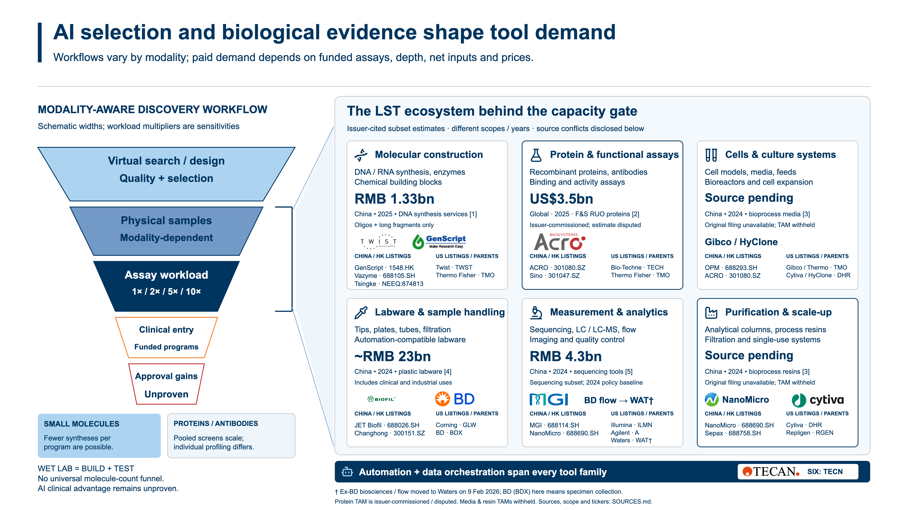
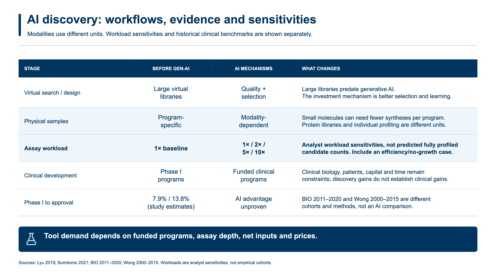
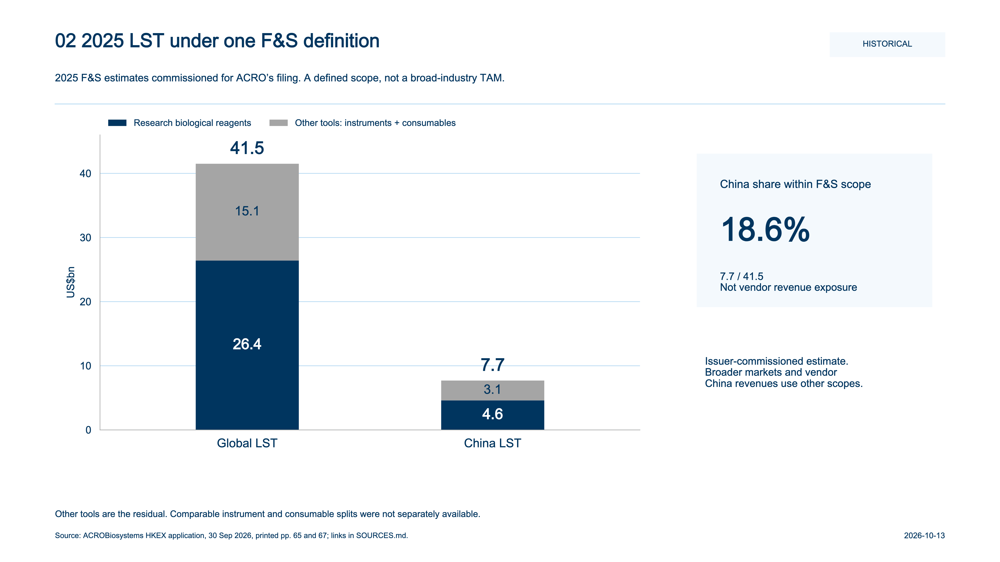
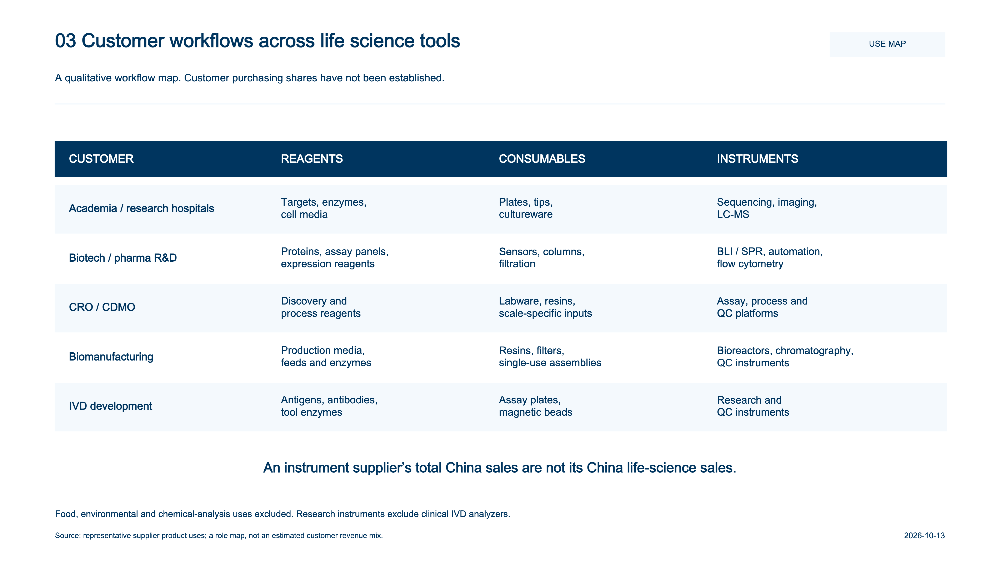
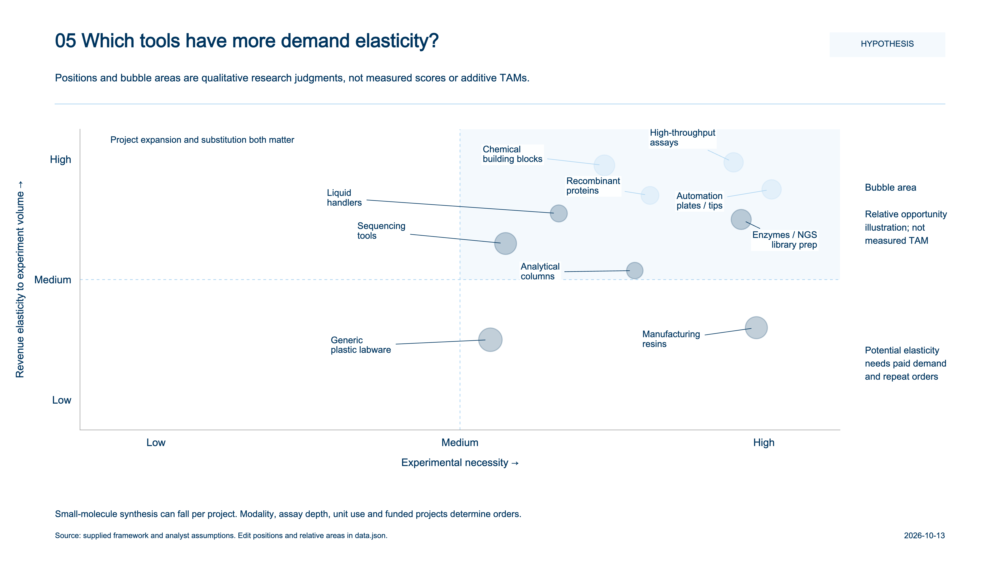
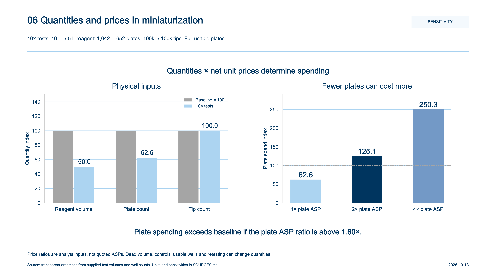
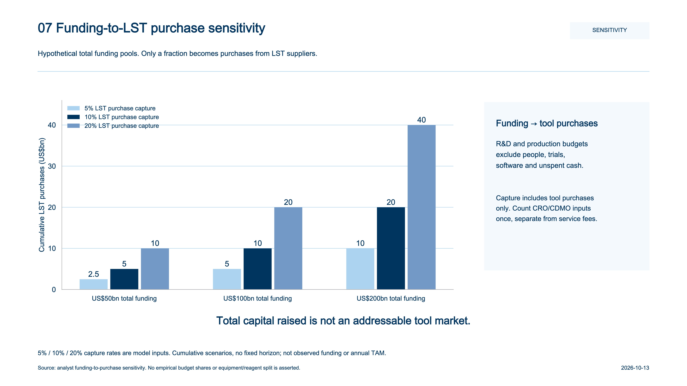

# AI and Life Science Tools — Research Graphics

An English research kit examining how AI-scale candidate generation could shift capacity pressure toward physical construction and experimental validation. ACROBiosystems and NanoMicro are highlighted as two different product pathways, not as investment recommendations.

## Public website

The interactive web edition is prepared at **https://wizardzxx-tech.github.io/chart/v2/**. The site source is in [`v2/`](v2/), with a dark/light theme, a discovery funnel, supplier details, a scenario calculator and a sixteen-figure research atlas. The repository root redirects to the web edition. The original local gallery is retained as [`gallery.html`](gallery.html).

For the repository's initial GitHub Pages activation, choose **Settings → Pages → Deploy from a branch → main → /(root) → Save**. After activation, future main-branch updates publish automatically. `.nojekyll` keeps this as a static site.

## RSI: AI design and biological validation — Figure 16

[Edit the English RSI loop](https://wizardzxx-tech.github.io/chart/v2/editor.html?figure=16) · [Editable PowerPoint](editable/RSI_AI_biology_loop_editable.pptx) · [PDF](RSI_AI_biology_loop.pdf) · [SVG](svg/16_rsi_ai_design_biology_validation.svg) · [Primary sources](rsi-loop/SOURCES.md)

This conceptual recursive self-improvement loop connects AI design to physical construction, biological validation, experimental data and model/policy updates. A gate promotes only verified capability gains. The diagram distinguishes demonstrated closed-loop biological learning from the hypothesis of sustained autonomous RSI and shows the LST infrastructure supporting each experimental cycle.

## Protein / antibody screening workflow — Figure 15

[Edit the English figure on the web](https://wizardzxx-tech.github.io/chart/v2/editor.html?figure=15) · [Editable PowerPoint](editable/Protein_antibody_workflow_editable.pptx) · [PDF](Protein_antibody_workflow.pdf) · [SVG](svg/15_protein_antibody_screening_workflow.svg) · [Sources](workflow/SOURCES.md)

Six stages map DNA construction, expression/purification, binding screens, multi-property characterization, cellular function and data feedback to representative reagents, instruments, consumables and suppliers. Stages 4–5 highlight potential constraints on generating rich, comparable experimental data for AI. All diagram text, frames and arrows are editable; original logos remain images. Supplier examples are not rankings or realized AI revenue claims.

## Main editable graphics

[Download the editable PowerPoint](editable/AI_LST_editable_research_graphics.pptx) · [Read the 12-page PDF](AI_LST_research_graphics.pdf) · [Browse the local HTML gallery](index.html) · [Sources and definitions](SOURCES.md)

The PowerPoint has two slides: a native stage-comparison table, followed by a native funnel and an enlarged LST ecosystem on the right. Table cells, text, funnel shapes, connectors and market labels can be edited individually. Logos and icons are embedded, replaceable images. The SVG exports retain editable text and vector geometry.

## Reading the evidence

The supplied stage counts are illustrative assumptions normalized **per one clinical entrant**. The separate reference funnel used a different denominator, per approved drug; only its visual form is adapted here. The AI-era approval outcome remains unknown. Funnel widths are schematic.

Market anchors keep their original geography, year, currency and scope. They are **not additive**, and each anchor sizes a selected product subset rather than an entire ecosystem box. The media and resin values marked with an asterisk were checked against the official filing index during the preceding research; the original Duoning PDFs are currently unavailable. All investment pools, customer mixes and qualitative matrix positions are explicitly labeled as scenarios or hypotheses.

## Ten supporting figures

### 01 — The life science tools framework

[SVG](svg/01_lst_framework.svg) · [PNG](png/01_lst_framework.png)

### 02 — China and global LST markets

[SVG](svg/02_china_global_market.svg) · [PNG](png/02_china_global_market.png)

### 03 — How downstream demand differs

[SVG](svg/03_downstream_structure.svg) · [PNG](png/03_downstream_structure.png)

### 04 — AI discovery and its LST touchpoints

[SVG](svg/04_ai_workflow.svg) · [PNG](png/04_ai_workflow.png)

### 05 — Which tools have more demand elasticity?

[SVG](svg/05_demand_elasticity.svg) · [PNG](png/05_demand_elasticity.png)

### 06 — More experiments, less material per experiment

[SVG](svg/06_miniaturization.svg) · [PNG](png/06_miniaturization.png)

### 07 — Illustrative AI-driven investment scenarios

[SVG](svg/07_investment_scenarios.svg) · [PNG](png/07_investment_scenarios.png)

### 08 — Potential supply constraints over 12–24 months

[SVG](svg/08_supply_bottlenecks.svg) · [PNG](png/08_supply_bottlenecks.png)

### 09 — Mapping Chinese listed LST suppliers

[SVG](svg/09_ashare_mapping.svg) · [PNG](png/09_ashare_mapping.png)

### 10 — From AI funding to LST shareholder returns

[SVG](svg/10_investment_logic.svg) · [PNG](png/10_investment_logic.png)

## Files and editing

| File | Purpose |
|---|---|
| `editable/AI_LST_editable_research_graphics.pptx` | Native editable table, funnel, connectors and ecosystem labels |
| `svg/` | Twelve text-editable vector graphics |
| `png/` | Twelve 4800 × 2700 PNG exports |
| `AI_LST_research_graphics.pdf` | Main graphics first, then the ten supporting figures |
| `data.json` | Supporting-figure values and qualitative placements |
| `ecosystem_data.json` | Editable table values and ecosystem contents |
| `data/stage_comparison.csv` | Stage assumptions and denominator |
| `data/market_anchors.csv` | Values, units, years, boundaries and source URLs |
| `generate_charts.py` | Matplotlib renderer for figures 01–10 |
| `generate_editable_graphics.mjs` | Artifact Tool authoring source for the two editable graphics |
| `assets/sources.json` | Logo/icon provenance and modifications |
| `qa_report.json` | Calculation, geometry, language and structural validation summary |

For direct editing, open the PowerPoint and select a table cell or individual object. Open an SVG in a vector editor to edit its labels and geometry.

To regenerate supporting figures, install `requirements.txt`, then run `python generate_charts.py --out . --data data.json`. Set `LST_CHART_FONT` to a local TrueType font if needed. Fonts are not redistributed.

To rebuild the editable deck in a Codex environment with Artifact Tool, set `PRESENTATIONS_SKILL_DIR`, `RUNTIME_NODE_MODULES`, `RUNTIME_NODE`, and `RUNTIME_PYTHON` to the installed skill and runtime locations. Make `@oai/artifact-tool` available to Node, update `ecosystem_data.json`, and run `node generate_editable_graphics.mjs`. The builder writes a fresh PPTX filename; `LST_PPTX_OUTPUT` can select another unused destination. When changing sourced values, update their citations and scope notes as well.

The exported deck passed package integrity, declared geometry, font-policy and first-party reimport checks. All twelve graphics were visually reviewed. Native editing in PowerPoint or Google Slides was not executed, so cross-application behavior is not claimed to be tested.

Research date: **12 October 2026**. Company trademarks remain the property of their owners and identify representative suppliers; they do not imply endorsement. Lucide icons are included under the ISC license in `assets/icons/LICENSE`.

## Palette and supplier update — 13 October 2026

All 16 English figures and the website use the supplied palette: navy #00355F, light blue #ACD4F1, gray #A5A5A5, mid blue #7399C6, green #078549, lime #8BC346, orange #F67F26 and red #BE3232, in that priority order. Original company logos retain their brand colors.

Figure 12 includes 22 distinct listed suppliers or parents, with Chinese/HK and US listing groups and Tecan on SIX. Brand tickers indicate parent companies; listing groups do not indicate corporate domicile. ACROBiosystems is 301080.SZ. BD (BDX) supplies specimen-collection products. Its former Biosciences / flow business is assigned to Waters (WAT), following the transaction completed on 9 February 2026. See [ticker sources](palette/TICKER_SOURCES.md) and [supplier CSV](data/supplier_tickers.csv).

[All 16 text-editable slides](editable/AI_LST_all_16_text_editable.pptx) · [All 16 figures as PDF](AI_LST_all_16_research_graphics.pdf) · [Edit the updated funnel](v2/editor.html?figure=12).

The combined deck uses native editable text lines over original chart artwork. The separate decks for Figures 11–16 also contain native tables, shapes and connectors; logos and icons remain images. Figures, market data, and scenario labels outside Figure 12 retain their previous text.

## Evidence and figure update - 13 October 2026

The website now separates molecule modalities, analyst workload sensitivities, quantity/price effects and funding-to-tool purchase capture. Unavailable media/resin source figures are withheld from headline TAMs; recombinant-protein estimates are compared without combining their years/scopes. [Review notes](REVIEW_NOTES.md). Figure 13 uses synthetic numeric values with magnitude shading; all nine properties are explained in the [English label guide](https://wizardzxx-tech.github.io/chart/v2/#metric-glossary). Affected SVG/PPT/PDF downloads are synchronized.
